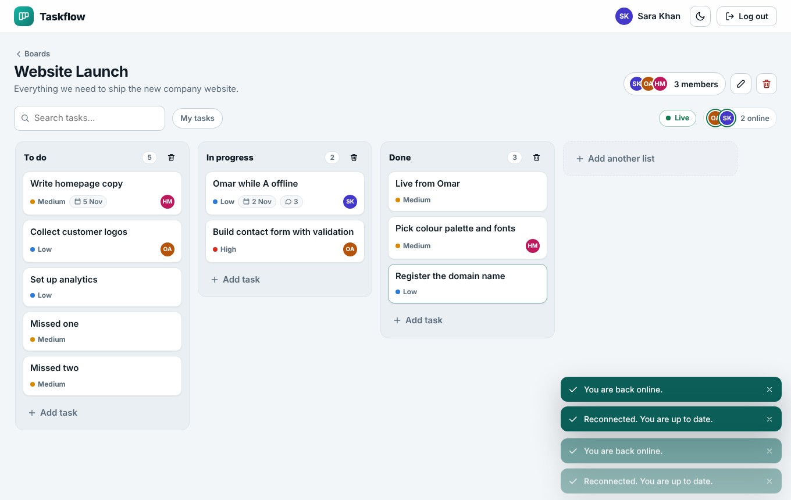
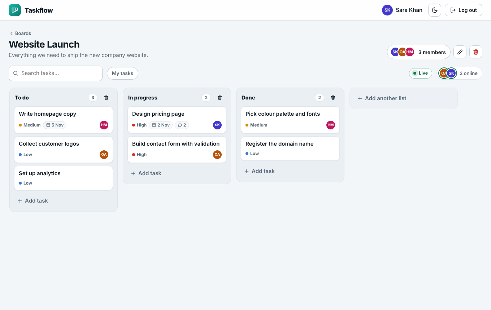
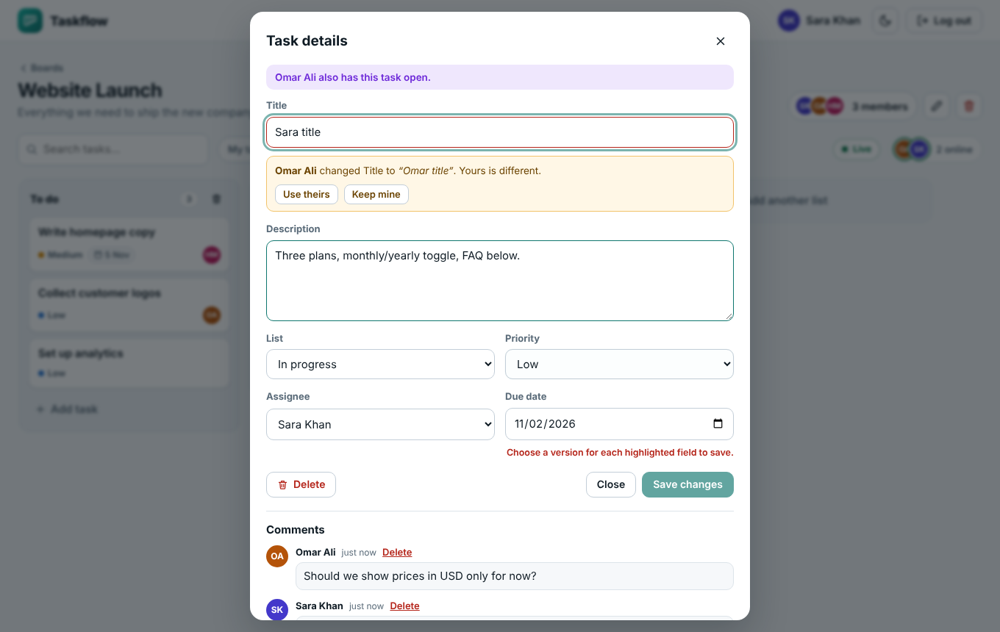
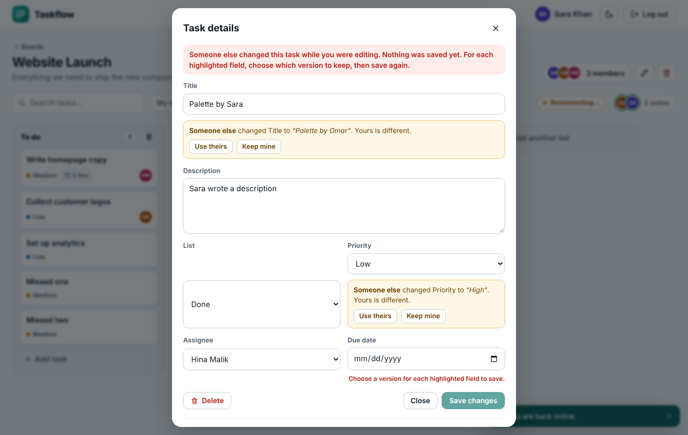

# Taskflow Live: Real-Time Collaboration

The Kanban project board from Task 7, now with **live updates**: when a teammate adds, edits, moves or comments on a task, **you see it instantly** without refreshing. It also shows **who is online**, survives **disconnects**, ignores **duplicate events** and handles **conflicting edits**.

Built for the Varolline Web Developer internship (Task 8) with **Node.js + Express** on the back end and plain **HTML, CSS and JavaScript** on the front end.

**Author:** Mahin Saleem  
**Repository:** https://github.com/mahinsaleem001-debug/Web_Developer_Varolline_Task8



## Real-time features (Task 8)

| Requirement | How it is delivered |
|---|---|
| Live updates (WebSockets or SSE) | **Server-Sent Events**. One stream per open board: new/edited/moved/deleted tasks, comments, lists, members and board changes appear for everyone at once. Cards changed by someone else flash briefly. |
| Show who is online | Avatars and "N online" above the board; a green "Online" tag in the members list; a purple "editing" badge on a card while a teammate has its window open. |
| Handle disconnects | Status pill (**Live / Reconnecting / Offline**). The browser reconnects by itself, the server **replays missed events** using `Last-Event-ID`, a heartbeat watchdog restarts silent streams, backoff with jitter after hard failures, and a full **resync** when the history is too old (for example after a server restart). |
| Handle duplicate events | Events have consecutive version ids: duplicates are ignored, gaps trigger a resync, applying is idempotent. Retried creates use an **`Idempotency-Key`**, so a retry after a timeout never makes a second task or comment. |
| Handle conflicting edits | Field-level detection with `baseRev`. Edits to different fields **merge automatically**; the same field gives a **409** and the window shows both versions with *Use theirs / Keep mine*. Conflicts also appear **live**, before you press Save. |
| Design write-up | [docs/DESIGN.md](docs/DESIGN.md) |

Everything from Task 7 still works: accounts, boards, lists, tasks, comments, assignees, permissions, drag-and-drop with rollback, search, dark theme.

### Try it in two browsers
1. `npm install`, `npm run seed`, `npm start`, open http://localhost:3000.
2. Log in as `sara@example.com` in a normal window and `omar@example.com` in a **Private/Incognito** window (password `Demo1234`), and open the same board in both.
3. Add, drag and comment in one window and watch the other. Open the same task in both and change the same field to see the conflict choice. Turn the network off in one window (DevTools > Network > Offline), make changes in the other, then turn it back on: the missed changes arrive.

## Setup

You need **Node.js 18 or newer** ([nodejs.org](https://nodejs.org)).

```bash
npm install
npm start
```

Open **http://localhost:3000**, create an account, and make your first board.

Optional demo data (3 users and a sample board):

```bash
npm run seed
```
Then log in as `sara@example.com` (or `omar@example.com`, `hina@example.com`) with password `Demo1234`.

Run the tests (no extra setup):

```bash
npm test
```

> **Windows PowerShell:** if `npm` is blocked by the execution policy, use `npm.cmd install` and `npm.cmd start`.

### Configuration (optional)

Copy `.env.example` to `.env` to change `PORT`, `DATA_FILE` or `JWT_SECRET`. Without a `JWT_SECRET`, a random one is generated once and saved in `data/.secret`. Never commit real secrets.

## Project structure

```
server/
  hub.js          Real-time hub: SSE streams, replay buffer, presence, resync
  index.js        Starts the server (loads config, secret and database file)
  app.js          Express app: auth, permissions, all API routes, security headers
  db.js           JSON-file database (in memory + atomic write to disk)
public/
  index.html      Page shell and dialogs
  css/style.css   Design tokens (light/dark), layout, components, responsive rules
  js/validate.js  Validation rules shared by browser AND server
  js/sync.js      Applies live events to the local board (duplicates, gaps, revisions)
  js/live.js      EventSource connection: reconnect, watchdog, backoff, online/offline
  js/api.js       fetch wrapper: timeout, CSRF header, one error type
  js/ui.js        Helpers: element builder, icons, toasts, confirm dialog, avatars
  js/app.js       Screens: auth, boards, board, drag-and-drop, task window, members
scripts/seed.js   Optional demo data (uses the real API)
tests/            42 automated tests (API, permissions, real-time, conflicts, sync logic)
docs/API.md       API documentation
```

## How it works

- **Data model:** `users`, `boards`, `members` (user + board + role), `columns`, `tasks`, `comments`. Task order is stored as a `position` number per list.
- **Permissions in one place:** every route resolves the board through the logged-in user's membership first, so a missing or foreign id always becomes `404`.
- **Moving a task:** `POST /api/tasks/:id/move { columnId, index }` removes the task from its list, inserts it at `index` in the destination and renumbers both lists to `1..n`. The browser runs the same algorithm locally for the instant update.
- **Sync:** every change bumps `board.version`; write responses return it in a header, so the browser knows whether the change was its own or a teammate's, and reloads only when needed.
- **Validation twice:** `public/js/validate.js` is used by the form (instant feedback) and by the server (the real check), so both always agree.

## Security

- Passwords hashed with **bcrypt**; login does the same work for unknown emails and gives one generic error (no account enumeration).
- Session cookie is `HttpOnly` + `SameSite=Strict`; writes require a custom header (**CSRF** defence); login/signup are **rate limited**.
- Strict **Content-Security-Policy** (no inline scripts or styles), `X-Frame-Options`, `nosniff`.
- All user text is rendered with `textContent` (no `innerHTML`), so stored text can never run as HTML.
- Request body size is limited; input is validated and trimmed on the server.

## Screenshots

| Who is online + Live status | Live conflict note | Conflict found when saving (409) |
|---|---|---|
|  |  |  |

| Board with live changes | Boards | Login |
|---|---|---|
|  | | |

## Known limits

The JSON-file database suits a single server and small teams. For many users, replace `server/db.js` with PostgreSQL or SQLite; the routes would stay the same. Live events and presence are kept in the memory of one server process (several servers would need a shared broker such as Redis); see [docs/DESIGN.md](docs/DESIGN.md) for the trade-offs. Touch screens use the "List" dropdown in the task window to move tasks.

## AI tool usage

Built with assistance from an AI tool (Claude). I reviewed, ran and tested all code and can explain each part.
